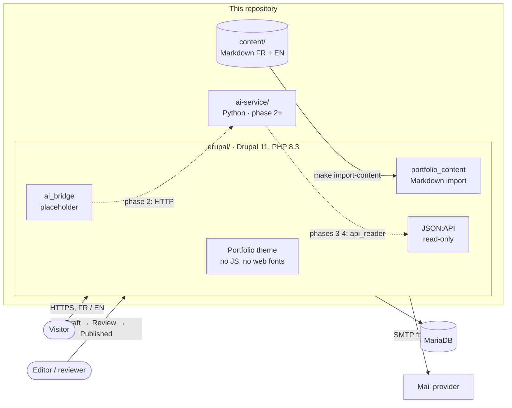

# Drupal + AI portfolio

[](https://github.com/riaze/drupal-ai-portfolio/actions/workflows/ci.yml)

French/English portfolio and consulting site of a Drupal and AI integration
developer. This repository holds the deployable Drupal 11 site, the content
as Markdown, and the place for the AI service that later phases add.

Phase 1, the current phase, is the foundation: a fast, accessible, bilingual
Drupal site with an editorial workflow, content imported from Markdown, and
the seams the AI features will plug into. **No AI module, vector database or
chatbot is installed yet.**

## Architecture



Details: [docs/architecture.md](docs/architecture.md). Decisions:
[ADR 0001](docs/adr/0001-drupal-core-over-a-distribution.md) Drupal core over
a distribution, [ADR 0002](docs/adr/0002-drupal-and-python-service-split.md)
Drupal and Python service split,
[ADR 0003](docs/adr/0003-no-analytics-and-no-cookie-banner.md) no analytics
and no cookie banner.

## Repository layout

| Path | Contents |
| --- | --- |
| `drupal/` | Drupal 11 Composer project, DDEV config, `config/sync`, custom code |
| `drupal/web/modules/custom/portfolio_content` | Markdown format, description token, content importer, contact form tweaks |
| `drupal/web/modules/custom/ai_bridge` | Seam for the AI service: interface and null implementation |
| `drupal/web/themes/custom/portfolio` | Theme: one stylesheet, light/dark, no JavaScript |
| `content/` | Site content in Markdown, `fr/` and `en/` ([guide](content/README.md)) |
| `ai-service/` | Python AI service, placeholder ([plan](ai-service/README.md)) |
| `infra/` | Infrastructure as code, placeholder |
| `docs/` | Architecture, ADRs, branch protection |
| `scripts/` | Lighthouse and Git hook helpers |

## Run it locally

Requirements: a Docker provider, [DDEV](https://docs.ddev.com/) 1.25 or later,
GNU Make. Optional: `pre-commit` and `gitleaks` for the Git hooks, Node.js and
Chrome for Lighthouse.

```bash
git clone git@github.com:riaze/drupal-ai-portfolio.git
cd drupal-ai-portfolio
make setup     # DDEV, Composer, install from config/sync, import content/
make hooks     # Git hooks: linters, gitleaks, Conventional Commits
```

`make setup` prints a one-time login link. The site runs at
<https://drupal-ai-portfolio.ddev.site> (French) and `/en` (English); run
`mkcert -install` once so the browser trusts the local certificate. Emails
are caught by Mailpit: `cd drupal && ddev mailpit`.

Content starts as drafts with `[[placeholders]]`: write your text in
`content/`, set `status: published`, then `make import-content`.

## Make targets

| Target | What it does |
| --- | --- |
| `make setup` | First run: start DDEV, install dependencies, install the site from `config/sync`, import content |
| `make start` / `make stop` | Start or stop the DDEV environment |
| `make lint` | `composer validate`, PHPCS (Drupal, DrupalPractice), PHPStan level 6 |
| `make test` | PHPUnit: unit tests and the kernel test of content types and roles |
| `make import-content` | Import `content/fr` and `content/en`; only changed files are applied |
| `make export-config` | Export the active configuration to `drupal/config/sync` |
| `make config-check` | Fail if the active configuration differs from `drupal/config/sync` |
| `make lighthouse` | Lighthouse scores of the key pages (reports in `reports/lighthouse`) |
| `make secrets-scan` | gitleaks over the whole Git history |
| `make hooks` | Install the pre-commit and commit-msg hooks |

In CI (`CI=true`) `make lint` and `make test` run without DDEV.

## Working on the site

- **Content** lives in `content/` (see [content/README.md](content/README.md)).
  The importer is idempotent, keeps edits made in Drupal until the file
  changes, and refuses to publish a file that still has a placeholder.
- **Configuration** changes are made in the admin UI or with Drush, then
  `make export-config` and committed. `make config-check` and CI fail when code
  and exported configuration differ.
- **Commits** follow [Conventional Commits](https://www.conventionalcommits.org/)
  (checked by the commit-msg hook). Pull requests use the template in
  `.github/`; `main` is protected as described in
  [docs/branch-protection.md](docs/branch-protection.md).
- **Secrets** never go to Git: every secret comes from an environment
  variable (see the
  [production environment contract](docs/architecture.md#production-environment-contract)).

## Quality and CI

GitHub Actions runs on every pull request and push to `main`
([ci.yml](.github/workflows/ci.yml)): `composer validate`, cached
`composer install`, `composer audit`, PHPCS, PHPStan, PHPUnit, a fresh install
from `config/sync` followed by the config drift check and a dry run of the
content import, and a gitleaks scan of the full history. Dependabot updates
Composer packages, GitHub Actions and pip weekly.

## Performance and accessibility

Lighthouse 13.6.0, mobile emulation with simulated throttling, measured on
2026-11-26 against the local DDEV site with the template content (`make
lighthouse`):

| Page | Performance | Accessibility | Best practices | SEO |
| --- | --- | --- | --- | --- |
| `/` (home, FR) | 100 | 100 | 100 | 100 |
| `/en` (home, EN) | 100 | 100 | 100 | 100 |
| `/a-propos` | 100 | 100 | 100 | 100 |
| `/mentions-legales` | 100 | 100 | 100 | 100 |
| `/en/privacy-policy` | 100 | 100 | 100 | 100 |
| `/services` | 100 | 100 | 100 | 100 |
| `/contact` | 100 | 100 | 100 | 100 |

First and largest contentful paint 0.8 s, total blocking time 0–10 ms,
cumulative layout shift 0, 6–8 KB transferred per page. These pages have no
images yet: run `make lighthouse` again once real content and images are
published, and on the production host.

## Roadmap

| Phase | Scope | Status |
| --- | --- | --- |
| 1. Foundation | Bilingual Drupal 11 site, content model, editorial workflow, Markdown import, theme, SEO, legal pages, CI | Done |
| 2. LLM suggestions | ai-service suggests article summaries, image alt text and tags; editors approve or reject them (`field_ai_review_status`); `ai_bridge` becomes an HTTP client | Next |
| 3. RAG assistant | Answers about services and case studies from published FR/EN content, indexed through JSON:API with the `api_reader` account | Planned |
| 4. MCP server | Exposes published content to AI clients, read-only, through the same `api_reader` access | Planned |
| Platform | Hosting in `infra/`, security headers (CSP), Drupal 12 upgrade (PHP 8.5) once 11.5 LTS and contrib are ready | Planned |
