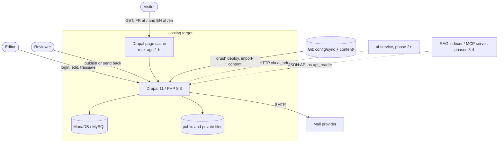

# Architecture

This document describes the phase 1 foundation: what runs, how content and
configuration flow, and what any hosting target must provide. Decisions with
alternatives are recorded as ADRs in [`adr/`](adr/).

## Context



Dotted links do not exist yet: only their seams do (the `ai_bridge` module,
the `api_reader` role, read-only JSON:API, `field_ai_review_status`).

## Drupal

- Drupal 11.4 (`drupal/recommended-project`), Standard profile, PHP 8.3,
  docroot `drupal/web`, DDEV for local development.
- Core modules beyond Standard: language, locale, content_translation,
  config_translation, content_moderation, workflows, media, jsonapi, contact,
  responsive_image. Contrib: admin_toolbar, key, honeypot, token, pathauto,
  metatag (with Open Graph), simple_sitemap; devel in development only.
- Drupal 11.4's Standard profile ships the new `navigation` sidebar; it is
  replaced by the toolbar with admin_toolbar, so the admin UI has one menu.

### Custom code

| Extension | Responsibility |
| --- | --- |
| `portfolio_content` | Markdown text format (CommonMark, raw HTML escaped, unsafe links dropped, `#` demoted to `<h2>`), `[node:portfolio_description]` token, content importer and Drush command, contact form privacy notice, Contact and FAQ menu links |
| `ai_bridge` | `AiBridgeInterface` with a null implementation. Phase 2 replaces it with an HTTP client of `ai-service` |
| `portfolio` theme | One stylesheet, no JavaScript, no web fonts; hooks in `src/Hook/PortfolioThemeHooks.php` |

## Content model

All content types are translatable; the source language is French.

| Type | Fields | Workflow |
| --- | --- | --- |
| Page | title, body | Unpublished by default, published by an administrator |
| Service | title, summary, body, display order, call to action (link + label) | Same as Page |
| Case study | title, summary, problem, solution, results, stack (terms), repository and demo links, image (alt required) | Draft → Review → Published |
| Article | title, body, summary (empty by default), tags, image (alt required), publication date, AI review status (none, suggested, approved, rejected) | Draft → Review → Published |
| FAQ | question (title), answer (body), category | Same as Page; listed on `/faq`, entries are `noindex` |

- Bodies and long texts use the **Markdown** format only. Content stays in
  Markdown in the database, which keeps the files in `content/` and the
  database comparable, and suits AI processing later.
- Images are shared by all translations; only the alternative text is
  translated. Derivatives are WebP (`portfolio_*` image styles) served with
  `srcset`/`sizes` (responsive image styles `portfolio_content` and
  `portfolio_card`).
- Vocabularies: `tags` (per language), `stack` (language neutral),
  `faq_category` (translated).
- Listings are views filtered on the content language: `/services`,
  `/case-studies`, `/blog`, `/faq` (and their `/en/…` versions); their blocks
  form the front page sections and hide when empty. Case study pages get
  `/realisations/…` aliases in French and `/en/case-studies/…` in English.
- The front page is the `home` page node. `system.site:page.front` is `/home`
  and the importer always gives that node the `/home` alias in both
  languages, so no node ID is stored in configuration.

## Content as Markdown

`content/<langcode>/**/*.md` files are imported by
`drush portfolio:import-content` (`make import-content`); see
[content/README.md](../content/README.md) for the file format.

- **Identity:** files with the same `id` in `fr/` and `en/` are translations of
  one node. Every imported entity (node, term, menu link, file) gets a
  name-based UUID (version 5) derived from its id, so the same files map to
  the same entities on every environment, without storing IDs anywhere.
- **Idempotency:** a hash per translation is kept in the key-value store.
  Unchanged files are skipped, so edits made in Drupal survive until the file
  changes. `--force` re-applies everything, `--dry-run` only validates (CI
  runs it).
- **Safety:** files are validated per type, and publishing is refused while a
  `[[placeholder]]` remains. Drafts are never visible to visitors.
- **No configuration changes:** the importer writes content only, so the
  config check stays clean after an import.
- Article summaries are never overwritten with an empty value: they are
  reserved for human-written or AI-suggested, human-approved text.

## Editorial workflow and roles

Workflow `editorial` on Article and Case study: Draft → Review → Published,
with transitions *create new draft*, *submit for review*, *send back to
draft*, *publish*.

| Role | Can | Cannot |
| --- | --- | --- |
| `editor` | Create and edit all content types and translations, use Markdown, create tags and stack terms, set URL aliases, move moderated content to Draft or Review | Publish, delete, administer anything |
| `reviewer` | Publish or send back articles and case studies, edit them while reviewing, view their revisions | Create content, administer anything |
| `api_reader` | `access content`: published content only, through the site or JSON:API | Anything else |
| anonymous | View published content, use the contact form | Anything else |
| authenticated | View published content | Inherited by every role, so kept minimal |

Self-registration is disabled. A kernel test (`SiteConfigurationTest`) fails
if a non-admin role gains an `administer …` or `bypass …` permission, if
editors can publish, or if `api_reader` gets more than `access content`.

JSON:API is read-only site-wide. Before phase 3 opens it to a service
account, restrict the exposed resources (for example user entities, whose
display names are public) and add authentication for `api_reader`.

## Multilingual

- French is the default language, without URL prefix; English is under `/en`.
  The language switcher names each language in its own language and sets
  `lang`/`hreflang`; translated pages carry `hreflang` alternates.
- Interface strings of custom code are translated in
  `translations/fr.po` of the theme and of `portfolio_content` (imported by
  locale on install and by `drush locale:update`).
- Configuration is French with English translations in
  `config/sync/language/en/`.

**Pitfall handled:** when English is not the default language, locale
regenerates the English overrides of module-shipped configuration from the
module's English source on every module install. Changing a translatable key
of shipped configuration (metatag defaults, for example) is therefore undone
in English. Such settings live in configuration that no module ships: the
meta description pattern is in per-bundle metatag defaults (`node__page`,
`node__article`, …).

## Front end

- No framework, no JavaScript, no web fonts, no external request. One
  aggregated stylesheet (custom properties, fluid type, mobile first).
- Light and dark schemes follow `prefers-color-scheme`; nothing is stored in
  the browser.
- Accessibility: skip link, one `<h1>` per page (Markdown `#` is demoted),
  landmarks (`header`, named `nav`s, `main`, `footer`), visible focus, WCAG AA
  contrast for every text color (ratios in `css/portfolio.css`), required alt
  text, `lang` on `<html>` and on language links, form `autocomplete`
  purposes, FAQ as native `<details>`, reduced motion respected.
- Lighthouse results and how to reproduce them: see the README.

## SEO

- Meta tags: `[title] | [site name]`, description from the summary or the
  start of the body (`[node:portfolio_description]`, slogan as fallback),
  canonical URL, Open Graph with the image derivative when there is one.
- `/sitemap.xml` (simple_sitemap) with `hreflang` alternates: pages,
  services, case studies, articles and the listing pages. Set
  `DRUPAL_BASE_URL` so it uses the public domain.
- Core `robots.txt`; clean URLs with pathauto patterns and per-language
  aliases from the front matter.

## Contact and email

- Site-wide form `feedback` at `/contact`, protected by Honeypot (hidden
  field and 5-second time limit, stored server side, no cookie) and core
  flood control (5 messages per hour per IP). The time limit makes `/contact`
  uncacheable for anonymous visitors; every other page stays cacheable.
- Messages are not stored in the database: they are sent to
  `DRUPAL_CONTACT_RECIPIENT`.
- Mail goes through core's Symfony mailer plugin when `SMTP_HOST` is set.
  The plugin is marked experimental in core; if it misbehaves on the chosen
  host, `drupal/symfony_mailer_lite` is the drop-in fallback.

## Performance

- Anonymous page cache with `Cache-Control: public, max-age=3600`, dynamic
  page cache, CSS aggregation, no JavaScript for visitors.
- Images: WebP derivatives, `srcset`/`sizes`, width and height set, lazy
  loading on cards and eager loading for the main image of a page.

## Configuration management

- `drupal/config/sync` is the source of truth and is committed. Change
  configuration locally, `make export-config`, commit.
- `make config-check` (and CI) fails when the active configuration differs
  from `config/sync`.
- devel is never exported (`config_exclude_modules` in `settings.php`).
- A fresh install is `drush site:install --existing-config` **followed by
  `drush deploy`**: after a French install from configuration, core deletes
  the English language when it had nothing to revert
  (`install_config_revert_install_changes()` in `core/includes/install.core.inc`
  sets `keep_english` only when it imports changes). The deploy re-imports
  English and its translations. `make setup` and CI both do this.

## Production environment contract

What any hosting target must provide. Nothing below is stored in Git.

### Environment variables

| Variable | Required | Purpose |
| --- | --- | --- |
| `DRUPAL_DB_NAME`, `DRUPAL_DB_USER`, `DRUPAL_DB_PASSWORD`, `DRUPAL_DB_HOST` | yes | Database connection (`DRUPAL_DB_PORT` defaults to 3306, `DRUPAL_DB_DRIVER` to `mysql`) |
| `DRUPAL_HASH_SALT` | yes | Random secret, for example `openssl rand -base64 55` |
| `DRUPAL_TRUSTED_HOSTS` | yes | Comma-separated host regexes, e.g. `^example\.fr$,^www\.example\.fr$` |
| `DRUPAL_SITE_MAIL` | yes | Sender address of site emails |
| `DRUPAL_CONTACT_RECIPIENT` | yes | Address receiving contact form messages |
| `SMTP_HOST`, `SMTP_PORT`, `SMTP_USER`, `SMTP_PASSWORD` | yes | SMTP relay; `SMTP_SCHEME` is `smtp` (STARTTLS, default) or `smtps` |
| `DRUPAL_BASE_URL` | yes | Public base URL used in the XML sitemap, e.g. `https://example.fr` |
| `DRUPAL_PRIVATE_PATH` | no | Private files directory (default `../private`) |
| `DRUPAL_REVERSE_PROXY_ADDRESSES` | no | Proxy IPs, when behind a load balancer or CDN |

### Platform

- PHP 8.3 or later with `gd` built with WebP support, `pdo_mysql`, `mbstring`,
  `xml`, `zlib` and OPcache; `memory_limit` of at least 256M.
- MariaDB 10.6+ or MySQL 8.0+ (MariaDB 11.8 locally and in CI).
- Web server pointing to `drupal/web`, HTTPS only.
- Writable: `drupal/web/sites/default/files` and the private directory.
- Cron: `automated_cron` runs every 3 hours from visitor requests; a system
  cron calling `vendor/bin/drush cron` hourly is preferable in production
  (then uninstall `automated_cron`).

### Deployment

```bash
cd drupal
composer install --no-dev --optimize-autoloader
vendor/bin/drush deploy -y                     # updates, config import, cache rebuild
vendor/bin/drush portfolio:import-content      # content/ changes
```

First deployment: `vendor/bin/drush site:install --existing-config -y`,
then the three commands above.

## Security notes

- Secrets only in environment variables; gitleaks in the pre-commit hook and
  in CI over the full history. See [SECURITY.md](../SECURITY.md).
- Markdown output escapes raw HTML; editors have no HTML-capable format.
- JSON:API is read-only; personal contact forms and self-registration are
  disabled.
- Backlog: Content-Security-Policy and other security headers at the web
  server or with a module, restricting JSON:API resources before phase 3.
